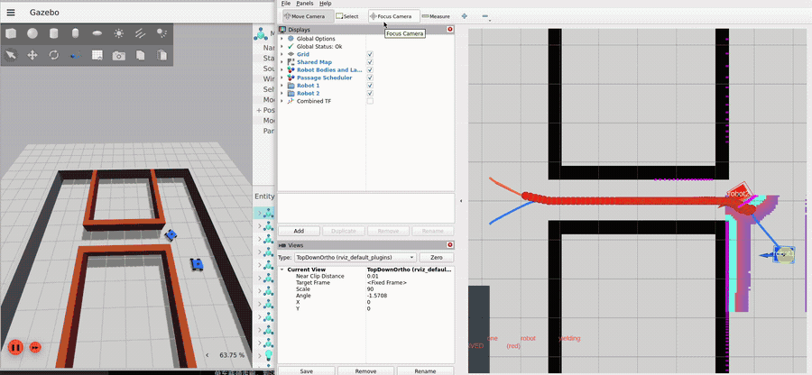
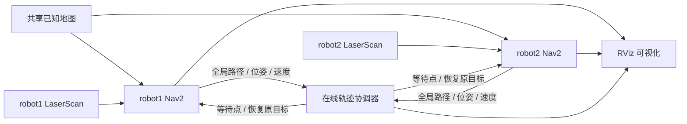
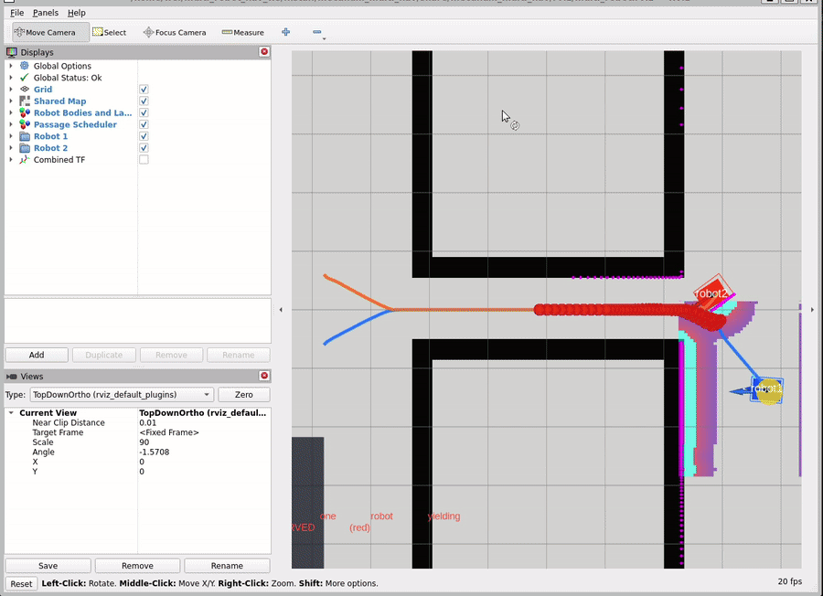
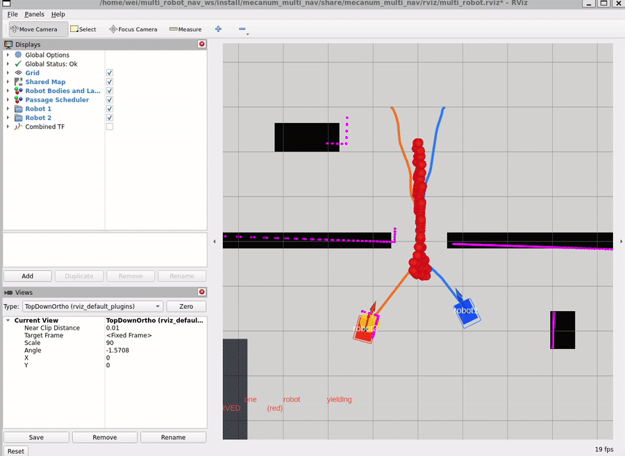

# Mecanum Multi-Robot Navigation

ROS 2 Humble + Nav2 + Gazebo Fortress 双麦克纳姆轮机器人协同导航与在线冲突调度演示。

<p align="center">
  <a href="docs/media/combined-demo.mp4">
    
  </a>
</p>

<p align="center"><em>Gazebo 与 RViz 联合演示。点击动画观看压缩 MP4。</em></p>

两辆全向移动机器人分别运行独立的 Nav2 导航栈，共享同一张已知地图。中央协调器持续读取两条全局路径和机器人实际状态，滚动预测时空冲突，在窄通道中动态选择先行车辆、生成等待点，并在冲突解除后释放让行车辆。两车最终以相同朝向并排停靠在目标区域。

## 功能概览

- 两套完整、带命名空间的 Nav2：`/robot1` 与 `/robot2`
- 共享地图，独立 AMCL 定位、全局规划、局部规划与代价地图
- 支持 `linear.y` 的麦克纳姆轮全向 DWB 控制
- 在线时空冲突检测，而非写死通道位置或固定等待车辆
- 根据任务优先级、预计到达时间和稳定平局规则动态分配通行权
- 自动计算冲突区之前的等待点，并滚动判断安全释放时机
- 将另一辆车纳入激光扫描与局部代价地图，支持动态避障
- 单个 RViz 同时显示两辆车、路径、footprint、扫描、代价地图和调度标记
- 提供普通窄通道、瓶颈走廊和基础双车导航场景

## 系统架构



每辆车使用唯一 TF 帧：

```text
map -> robot1/odom -> robot1/base_link -> robot1/lidar_link
map -> robot2/odom -> robot2/base_link -> robot2/lidar_link
```

两棵 TF 树汇总到公共 `/tf` 与 `/tf_static`，因此可以在一个 RViz 窗口中统一显示。

## 演示场景

### 瓶颈走廊

两辆车从下方开阔区域出发，依次通过只能容纳单车安全通行的长走廊，最后在上方目标区并排停靠。

<p align="center">
  
</p>

```bash
ros2 launch mecanum_multi_nav bottleneck_corridor_demo.launch.py
```

### 横向窄通道

两条独立路径在狭窄区域产生时空冲突，协调器根据在线预测动态建立和释放通行预约。

<p align="center">
  
</p>

```bash
ros2 launch mecanum_multi_nav narrow_passage_demo.launch.py
```

## 规划与协调方法

| 层级 | 实现 |
| --- | --- |
| 定位 | 每辆车独立运行 AMCL，共享同一张静态地图 |
| 全局规划 | 每辆车使用 NavFn 独立生成全局路径 |
| 局部规划 | DWB 全向运动模型，支持前进、横移与旋转 |
| 动态避障 | 局部代价地图使用 LaserScan 障碍层与膨胀层 |
| 冲突检测 | 按实际位姿和速度，以 5 Hz 滚动预测两条剩余轨迹的到达时间 |
| 通行权 | 任务优先级优先，其次比较预计到达时间，最后使用稳定平局规则 |
| 让行 | 沿让行车辆的路径自动选择冲突区前方等待点 |
| 释放 | 连续多个周期预测“立即恢复”后不再冲突，并满足实际车距要求 |

调度器不知道场景中的通道位置。红色标记表示当前预测到的冲突区，黄色圆盘表示等待点，冲突解除后标记变为绿色。蓝色和橙色轨迹分别表示两辆车的滚动预测结果。

## 环境要求

- Ubuntu 22.04
- ROS 2 Humble
- Nav2
- Gazebo Fortress / `ros_gz`
- RViz 2
- `colcon` 与 `rosdep`

## 安装

```bash
mkdir -p ~/multi_robot_nav_ws/src
cd ~/multi_robot_nav_ws/src
git clone https://github.com/lsiwei68-alt/mecanum-multi-robot-navigation.git mecanum_multi_nav

cd ~/multi_robot_nav_ws
source /opt/ros/humble/setup.bash
rosdep install --from-paths src --ignore-src -r -y
colcon build --symlink-install --packages-select mecanum_multi_nav
source install/setup.bash
```

## 快速运行

推荐从瓶颈走廊开始：

```bash
source /opt/ros/humble/setup.bash
source ~/multi_robot_nav_ws/install/setup.bash
ros2 launch mecanum_multi_nav bottleneck_corridor_demo.launch.py
```

默认隐藏 Gazebo GUI 并启动 RViz。需要观察 Gazebo 时：

```bash
ros2 launch mecanum_multi_nav bottleneck_corridor_demo.launch.py headless:=false
```

基础双车导航与编队停靠：

```bash
ros2 launch mecanum_multi_nav complete_demo.launch.py
```

只启动仿真与两套 Nav2，不自动下发任务：

```bash
ros2 launch mecanum_multi_nav dual_robot_nav.launch.py headless:=true
```

## 常用调度参数

```bash
ros2 launch mecanum_multi_nav narrow_passage_demo.launch.py \
  robot2_priority:=10 \
  clearance:=0.8 \
  time_margin:=4.0 \
  release_min_separation:=1.0 \
  release_confirmation_cycles:=5
```

调度状态发布在 `/coordination/state`：

```bash
ros2 topic echo --qos-durability transient_local /coordination/state
```

## 单车全向运动测试

```bash
ros2 launch mecanum_multi_nav single_robot_sim.launch.py headless:=true
ros2 run mecanum_multi_nav motion_smoke_test --ros-args -p robot_name:=robot1
```

测试依次执行前进、横移和旋转，用于确认底盘模型与速度接口支持全向运动。

## 迁移到真实机器人

仿真中的 `/robot1`、`/robot2` 命名空间、Nav2 参数、协调器接口和公共地图结构可以继续用于两台真实机器人。典型部署方式是：

- 每台 Jetson 分别运行本车的驱动、传感器、定位和 Nav2；
- STM32 负责轮速闭环等硬实时底盘控制；
- 上位机或任意一台 Jetson 运行中央轨迹协调器；
- 两台机器人位于同一局域网和 ROS Domain，并完成系统时间同步；
- 实车激光雷达继续发布相同格式的 `sensor_msgs/LaserScan`。

## 当前边界

- 当前协调器针对两辆机器人设计；
- 属于集中式在线优先级调度，不是联合状态空间中的最优 MAPF 求解器；
- 仿真扫描使用确定性的二维射线节点，便于稳定复现实验；接入实车时可直接替换为真实雷达话题；
- 后续可扩展优先级老化、多个冲突区、三车以上预约队列和分布式故障恢复。

## 目录结构

```text
config/                 Nav2 与控制参数
launch/                 仿真、导航、RViz 与场景启动文件
maps/                   共享地图
models/                 麦克纳姆轮机器人模型
rviz/                   单窗口双车显示配置
scripts/                协调器、传感器与演示节点
worlds/                 Gazebo 场景
docs/media/             README 演示媒体
```

## License

Apache-2.0
