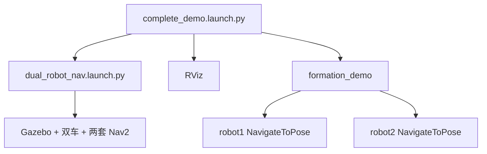
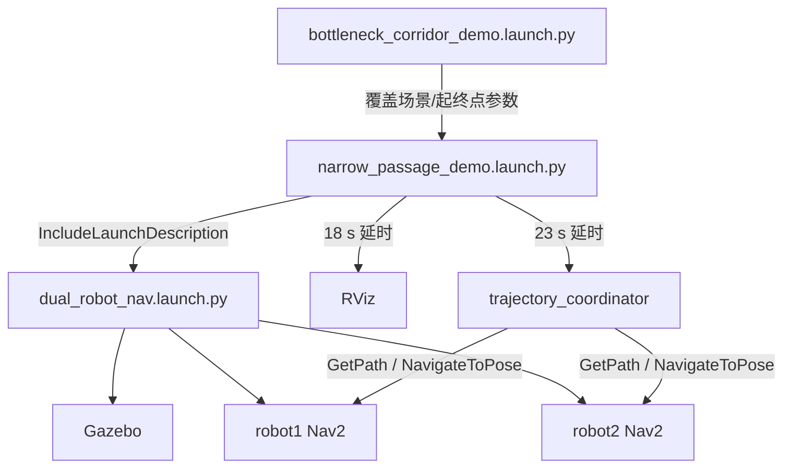
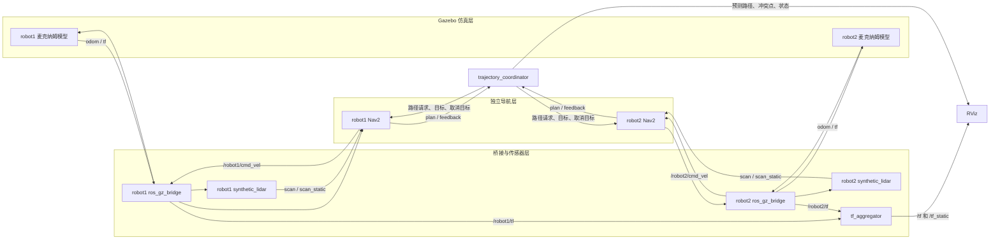
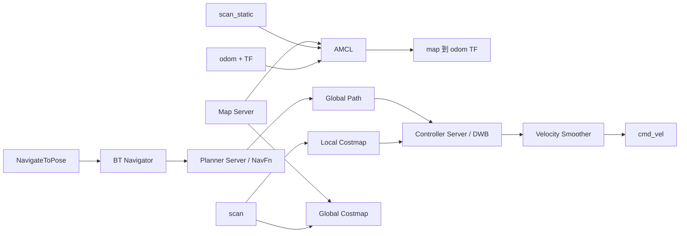
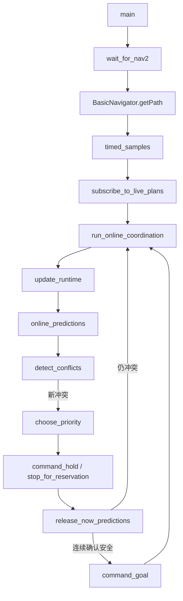
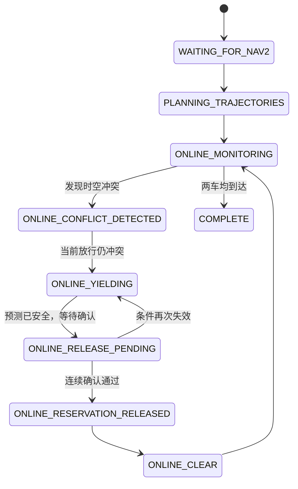

# 代码阅读指南：从仿真启动到双车在线调度

本文面向第一次阅读本项目代码的人，目标不是逐行翻译源码，而是回答下面几个问题：

- 应该从哪个文件开始读？
- 一条启动命令最终启动了哪些模块？
- Gazebo、传感器、TF、Nav2、协调器和 RViz 之间如何连接？
- 每个自编节点接收什么、输出什么？
- 两辆车的路径如何产生，冲突如何检测，让行又如何执行？
- 如果要修改场景、底盘、导航参数或调度算法，应当去哪个文件？

项目是一个 ROS 2 `ament_cmake` 包，但主要业务代码使用 Python 编写。核心思想是：**每辆车各自运行完整 Nav2，中央协调器只在任务层管理两条路径的时空冲突，不代替每辆车的局部控制器。**

---

## 1. 最推荐的阅读顺序

如果只想快速抓住主线，按下面顺序阅读。

### 第一遍：先看启动链

1. `launch/bottleneck_corridor_demo.launch.py`
   - 最短的场景入口。
   - 它只负责给通用演示传入世界、地图、起点和终点。
2. `launch/narrow_passage_demo.launch.py`
   - 在线调度演示的通用入口。
   - 它包含底层双车导航启动文件，并延时启动 RViz 和协调器。
3. `launch/dual_robot_nav.launch.py`
   - 整个仿真基础设施的总装文件。
   - Gazebo、机器人生成、桥接、雷达、TF 汇总和两套 Nav2 都从这里启动。

第一遍读完后，应当能回答：“一条 launch 命令为什么能同时出现两辆车、两套导航和一个协调器？”

### 第二遍：理解单车是怎么动起来的

4. `models/mecanum_robot.sdf.xacro`
   - 底盘、四个轮子、雷达、麦克纳姆驱动插件、里程计插件。
5. `config/nav2_omni.yaml`
   - AMCL、全局规划器 NavFn、局部规划器 DWB、代价地图和速度平滑器。
6. `scripts/synthetic_lidar`
   - 默认模式下雷达数据如何生成，以及为什么能扫描到另一辆车。
7. `scripts/tf_aggregator`
   - 为什么两套命名空间中的 TF 可以在一个 RViz 中显示。

第二遍读完后，应当能画出单车的数据闭环：

```text
地图 + 激光 + 里程计
        ↓
      Nav2
        ↓ cmd_vel
Gazebo 麦克纳姆驱动
        ↓ odom / tf
      Nav2
```

### 第三遍：理解在线调度

8. `scripts/trajectory_coordinator`
   - 项目最核心的业务代码。
   - 建议先读 `main()` 和 `run_online_coordination()`，再回头读工具函数。
9. `mecanum_multi_nav/nav2_readiness.py`
   - 协调器如何等待 Nav2 就绪，以及如何可靠提交目标。
10. `rviz/multi_robot.rviz` 与 `scripts/robot_markers`
    - 路径、冲突点、等待点、车体和调度状态如何显示。

### 最后再读辅助入口

- `launch/complete_demo.launch.py` + `scripts/formation_demo`
  - 基础双车并排到达演示，没有在线通行权调度。
- `launch/single_robot_sim.launch.py`
  - 单车仿真和底盘调试入口。
- `scripts/motion_smoke_test`
  - 前进、横移和旋转的底盘冒烟测试。
- `launch/dual_rviz.launch.py`
  - 只启动项目的 RViz 配置。

---

## 2. 项目目录的层次结构

```text
mecanum_multi_nav/
├── CMakeLists.txt                 # 安装 Python 包、脚本和资源
├── package.xml                    # ROS 2 包元数据与运行依赖
├── launch/                        # 系统装配层：决定启动哪些节点
│   ├── bottleneck_corridor_demo.launch.py
│   ├── narrow_passage_demo.launch.py
│   ├── complete_demo.launch.py
│   ├── dual_robot_nav.launch.py
│   ├── single_robot_sim.launch.py
│   └── dual_rviz.launch.py
├── models/
│   └── mecanum_robot.sdf.xacro    # 机器人仿真模型与 Gazebo 插件
├── worlds/                        # Gazebo 世界的真实几何和碰撞体
├── maps/                          # Nav2 使用的二维占据栅格地图
├── config/
│   └── nav2_omni.yaml             # 两套 Nav2 共用的参数模板
├── mecanum_multi_nav/
│   └── nav2_readiness.py          # 可复用的 Nav2 就绪/目标提交工具
├── scripts/                       # 本项目编写的 ROS 2 可执行节点
│   ├── trajectory_coordinator     # 在线双车调度核心
│   ├── formation_demo             # 基础并排到达演示
│   ├── synthetic_lidar            # 确定性二维仿真雷达
│   ├── tf_aggregator              # 汇总两套 TF
│   ├── robot_markers              # RViz 车体标记
│   └── motion_smoke_test           # 全向底盘运动测试
└── rviz/
    └── multi_robot.rviz            # 双车统一可视化配置
```

可以把它们归纳为六层：

| 层级 | 目录/文件 | 职责 |
| --- | --- | --- |
| 场景层 | `worlds/`、`maps/` | 定义真实仿真几何和导航认知地图 |
| 机器人层 | `models/mecanum_robot.sdf.xacro` | 底盘、轮子、传感器和 Gazebo 插件 |
| 连接层 | `ros_gz_bridge`、`synthetic_lidar`、`tf_aggregator` | 在 Gazebo、ROS 2 和 RViz 之间搬运数据 |
| 单车导航层 | `config/nav2_omni.yaml` | 每辆车独立定位、规划、避障和控制 |
| 多车协调层 | `trajectory_coordinator` | 比较两条轨迹并执行通行权/让行策略 |
| 展示层 | `robot_markers`、`multi_robot.rviz` | 显示车体、路径、雷达、代价地图和调度状态 |

---

## 3. 两条主要启动链

项目中有两种容易混淆的演示。

### 3.1 基础并排到达演示

启动入口：

```bash
ros2 launch mecanum_multi_nav complete_demo.launch.py
```

调用链：



`formation_demo` 只做三件事：

1. 根据中心目标、终点朝向和 `spacing` 计算两个并排停车位。
2. 用两种分配方式计算总直线距离，选择更短的车位分配。
3. 同时向两套 Nav2 发送最终目标并等待完成。

它**不做**时空冲突检测，也**不做**主动让行。

### 3.2 在线冲突调度演示

瓶颈场景启动入口：

```bash
ros2 launch mecanum_multi_nav bottleneck_corridor_demo.launch.py
```

完整调用链：



`bottleneck_corridor_demo.launch.py` 本身没有调度算法。它是一个“参数预设”：把瓶颈走廊世界、地图、双车起点和终点传给通用的 `narrow_passage_demo.launch.py`。

因此，新增一个同类场景时，通常不需要复制协调器，只需要复用通用演示入口并传入另一组参数。

---

## 4. 系统总数据流

下面是运行在线调度演示时最重要的数据关系。



一个重要边界是：

- 协调器不会直接连续发布轮速或 `/cmd_vel`。
- 协调器操作的是 Nav2 任务：请求路径、发送最终目标、取消目标、发送等待点。
- 真正的局部轨迹采样、障碍物检查和速度输出仍由每辆车自己的 DWB 与 controller server 完成。

---

## 5. `dual_robot_nav.launch.py`：系统总装文件

这个文件值得分成“辅助函数”和“启动动作”两部分读。

### 5.1 `_render_robot()`

输入：

- ROS 包路径；
- 机器人命名空间 `robot1` 或 `robot2`；
- 是否使用 Gazebo 原生雷达。

处理：

- 调用 xacro 展开 `models/mecanum_robot.sdf.xacro`；
- 把命名空间和雷达模式注入模型；
- 在系统临时目录生成实际 SDF 文件。

输出：可交给 `ros_gz_sim create` 的 SDF 路径。

### 5.2 `_render_nav2_params()`

输入：命名空间、初始位姿和雷达模式。

处理：

- 将 `config/nav2_omni.yaml` 中的 `__NS__` 替换为 `robot1` 或 `robot2`；
- 写入各自的 AMCL 初始位姿；
- 原生雷达模式下，把 AMCL 的 `scan_static` 改成 `scan`。

输出：每辆车独立的临时 Nav2 参数文件。

这解释了为什么源码中只有一份 Nav2 YAML，却能启动两套使用不同 TF 帧的导航栈。

### 5.3 `_robot_bridge()`

为一辆车桥接：

| ROS 2 侧 | 方向 | Gazebo 侧意义 |
| --- | --- | --- |
| `/<robot>/cmd_vel` | ROS → Gazebo | 底盘速度命令 |
| `/<robot>/odom` | Gazebo → ROS | 里程计 |
| `/<robot>/tf` | Gazebo → ROS | `odom → base_link` 动态 TF |
| `/<robot>/joint_states` | Gazebo → ROS | 关节状态 |
| `/<robot>/scan` | Gazebo → ROS | 仅原生雷达模式使用 |

### 5.4 `_static_lidar_tf()`

发布：

```text
robotN/base_link → robotN/lidar_link
```

并将标准 `/tf_static` 重映射到命名空间内的 `/<robot>/tf_static`，之后由 `tf_aggregator` 汇总。

### 5.5 `_nav2_bringup()`

它不是自己逐个创建 Nav2 节点，而是包含官方 `nav2_bringup/bringup_launch.py`，传入：

- namespace；
- 地图文件；
- 为该车生成的参数文件；
- `autostart=True`；
- `slam=False`。

所以 AMCL、map server、planner server、controller server、BT navigator、行为服务器和生命周期管理器都来自 Nav2 官方 bringup。

### 5.6 启动时序

默认合成雷达模式的大致时序为：

```text
t=0 s   Gazebo、clock bridge、车辆 bridge、合成雷达、TF 汇总节点启动
t=2 s   向 Gazebo 插入两辆车
t=5 s   启动 robot1 Nav2
t=10 s  启动 robot2 Nav2
```

外层的窄通道演示继续在：

```text
t=18 s  启动 RViz
t=23 s  启动 trajectory_coordinator
```

这些延时只负责降低同时加载造成的竞争。真正决定协调器能否工作的，是 `wait_for_nav2()` 对定位和 Action 接口的检查。

---

## 6. 机器人模型与运动接口

文件：`models/mecanum_robot.sdf.xacro`

### 输入

- `namespace`：生成 `robot1` 或 `robot2` 的话题/TF 名称；
- `native_lidar`：是否在模型中创建 GPU lidar。

### 组成

- `base_link`：0.48 m × 0.36 m 的车体；
- 四个轮子及四个 revolute joint；
- `lidar_link`；
- `MecanumDrive` 插件；
- `OdometryPublisher` 插件；
- `JointStatePublisher` 插件；
- 可选 `gpu_lidar` 传感器。

### 关键接口

```text
/robotN/cmd_vel  → MecanumDrive → 四轮运动
OdometryPublisher → /robotN/odom + /robotN/tf
JointStatePublisher → /robotN/joint_states
GPU lidar（可选） → /robotN/scan
```

`Twist.linear.x` 是前后，`Twist.linear.y` 是横移，`Twist.angular.z` 是旋转。这是全向车与普通差速车最直观的差别。

---

## 7. 地图、世界和合成雷达为什么必须一致

每个场景实际上有三份几何描述：

1. `worlds/<scene>.sdf`
   - Gazebo 中的碰撞体和可视模型，是仿真的“真实环境”。
2. `maps/<scene>.pgm` + `.yaml`
   - Nav2 和 AMCL 看到的二维占据栅格地图。
3. `scripts/synthetic_lidar` 中对应的 box 常量
   - 默认合成雷达用于射线求交的几何。

三者必须保持一致。否则可能出现：

- Gazebo 中有墙，地图中没有；
- 地图中有障碍，雷达扫描不到；
- AMCL 用扫描匹配地图时出现系统性偏差；
- 路径看起来可行，但仿真车实际撞墙。

所有地图当前均使用：

```yaml
resolution: 0.05
origin: [-5.0, -5.0, 0.0]
```

即每个栅格 5 cm，地图坐标原点对应图像左下区域的 `(-5, -5)`。

---

## 8. `synthetic_lidar`：默认雷达的数据设计

该节点每辆车启动一个实例。

### 输入

| 输入 | 类型 | 用途 |
| --- | --- | --- |
| `/<self>/odom` | `nav_msgs/Odometry` | 获得本车位置、朝向和时间戳 |
| `/<other>/odom` | `nav_msgs/Odometry` | 把另一辆车作为旋转矩形障碍物 |
| 参数 `scenario` | string | 选择静态障碍物几何 |

### 输出

| 输出 | 内容 | 消费者 |
| --- | --- | --- |
| `/<robot>/scan` | 静态环境 + 另一辆车 | 局部/全局代价地图、RViz |
| `/<robot>/scan_static` | 仅静态环境 | 默认模式下的 AMCL |

这里故意拆成两个扫描：

- AMCL 应该用稳定的静态环境进行地图匹配，不应该把另一辆移动机器人误当成地图墙体；
- 代价地图必须看到另一辆车，才能把它标记为动态障碍物。

每 0.1 秒生成一次 360 束扫描。`ray_box_distance()` 计算射线与轴对齐矩形的交点；`ray_oriented_box_distance()` 先把射线变换到另一辆车的局部坐标，再与其 footprint 求交。

扫描时间戳复用本车里程计时间戳，目的是让扫描与 `odom → base_link` TF 来自同一次仿真更新，避免 RViz/AMCL 因时间早于 TF 缓存而丢弃消息。

---

## 9. TF 和统一 RViz

每辆车的核心 TF 链为：

```text
map → robot1/odom → robot1/base_link → robot1/lidar_link
map → robot2/odom → robot2/base_link → robot2/lidar_link
```

来源分别是：

| TF | 发布者 |
| --- | --- |
| `map → robotN/odom` | 该车 AMCL |
| `robotN/odom → robotN/base_link` | Gazebo 里程计插件 |
| `robotN/base_link → robotN/lidar_link` | `static_transform_publisher` |

为了隔离两套 Nav2，动态和静态 TF 最初位于：

```text
/robot1/tf
/robot1/tf_static
/robot2/tf
/robot2/tf_static
```

`scripts/tf_aggregator` 订阅这四个话题并汇总发布到标准 `/tf` 与 `/tf_static`，供单个 RViz 使用。

静态 TF 使用 `TRANSIENT_LOCAL` QoS。汇总器会缓存两个机器人的全部静态变换，每次发布完整集合，确保晚启动或重启后的 RViz 不会只收到最后一辆车的静态 TF。

---

## 10. 每辆车的 Nav2 内部结构

文件：`config/nav2_omni.yaml`

两辆车使用同一个模板，但 launch 会替换命名空间和初始位姿。



### 10.1 定位：AMCL

- 模型：`nav2_amcl::OmniMotionModel`；
- 输入：已知地图、`scan_static`、`odom → base_link`；
- 输出：`map → robotN/odom`；
- 初始位姿：由 launch 根据仿真出生点写入参数。

这意味着当前仿真不是全局盲定位，而是从已知出生位姿开始运行粒子滤波。

### 10.2 全局规划：NavFn

```yaml
plugin: nav2_navfn_planner/NavfnPlanner
use_astar: false
```

输入：起点、终点、全局代价地图。

输出：`nav_msgs/Path`，通常可在 `/<robot>/plan` 看到。

两辆车各自独立规划。NavFn 并不知道另一辆车的未来意图；另一辆车最多作为当前激光障碍物进入代价地图。未来轨迹冲突由上层协调器处理。

### 10.3 局部规划与控制：DWB

```yaml
plugin: dwb_core::DWBLocalPlanner
max_vel_x: 0.30
max_vel_y: 0.18
max_vel_theta: 0.8
```

DWB 在局部时间范围内采样 `(vx, vy, wz)`，模拟候选运动并用 critics 评分，选出安全且贴近路径/目标的速度。

`max_vel_y` 小于 `max_vel_x`，用于模拟真机麦克纳姆轮横移更容易打滑、轮速预算更紧张的特性。

### 10.4 代价地图

全局代价地图：

- 静态地图层；
- 激光障碍层；
- 膨胀层。

局部代价地图：

- 3 m × 3 m 滚动窗口；
- voxel layer；
- inflation layer；
- 使用 `/<robot>/scan`，所以能感知另一辆车。

机器人 footprint 为：

```text
0.50 m × 0.38 m，加 0.02 m padding
```

### 10.5 速度平滑

`velocity_smoother` 对 Nav2 控制器输出施加速度、加速度和减速度限制，使运动更接近真机，最终速度命令到达 `/<robot>/cmd_vel`。

---

## 11. `nav2_readiness.py`：为何不直接 sleep 后发送目标

### `wait_for_nav2(navigator)`

循环检查四个条件：

1. `navigator.initial_pose_received`：定位已有初始位姿；
2. planner Action server 可用；
3. controller Action server 可用；
4. navigate-to-pose Action server 可用。

全部连续稳定 1 秒后才返回，默认最多等待 90 秒。

### `start_navigation(navigator, pose)`

刷新目标时间戳并调用 `goToPose()`。如果 Action 已发现但生命周期节点暂时不接收目标，它会每 0.5 秒重试，默认 30 秒超时。

因此 launch 中的固定延时只是错峰启动，接口就绪检查才是应用层可靠性的最后一道保护。

---

## 12. `trajectory_coordinator` 的核心数据结构

先读三个 dataclass：

### `TimedSample`

```text
路径点索引 + x + y + 预计到达该点的相对时间
```

它把普通几何路径提升为带时间参数的预测轨迹。

### `Conflict`

```text
robot1 路径索引
robot2 路径索引
冲突点中点坐标
两车预计到达时间
```

### `RobotRuntime`

保存一辆车运行期间的全部调度状态：

- BasicNavigator；
- 当前全局路径及时间采样；
- 最终目标；
- 实测位置和估计速度；
- 路径进度；
- 当前模式 `goal` 或 `hold`；
- Action 是否活跃、最终任务是否完成；
- 实时重规划订阅和版本号。

---

## 13. 在线协调算法的调用关系

建议先沿下面这条主线读：



### 13.1 初始路径生成

`main()` 创建两个带命名空间的 `BasicNavigator`：

```python
BasicNavigator(node_name='trajectory_coordinator', namespace='robot1')
BasicNavigator(node_name='trajectory_coordinator', namespace='robot2')
```

随后分别调用：

```python
navigator.getPath(start, goal, use_start=True)
```

这会请求两套 Nav2 planner server 独立生成路径。

### 13.2 路径时间化

`timed_samples(path, nominal_speed)` 沿路径累计距离：

```text
到达时间 += 相邻路径点距离 / 名义速度
```

运行后，`remaining_timed_samples()` 不断从实测位置和已走进度重新计算剩余到达时间。预测速度被限制在：

```text
minimum_prediction_speed ≤ speed ≤ maximum_prediction_speed
```

### 13.3 跟踪 Nav2 实时重规划

`subscribe_to_live_plans()` 分别订阅两个相对话题 `plan`。因为订阅创建在不同命名空间的 navigator 上，实际得到：

```text
/robot1/plan
/robot2/plan
```

`update_live_path()` 只接受终点仍接近最终目标的路径，避免把前往等待点的临时路径误认为新的最终全局路径。

### 13.4 冲突检测

`detect_conflicts()` 的逻辑是：

1. 对过密路径点降采样；
2. 对两条按时间排序的剩余轨迹使用滑动时间窗口；
3. 若两个样本满足：

```text
空间距离 ≤ clearance
且
到达时间差 ≤ time_margin
```

则记录为时空冲突。

另外，如果预测暂时没有冲突，但两车实测距离小于 `emergency_clearance`，程序会人工生成一个紧急冲突，避免只依赖预测模型。

### 13.5 优先级选择

`choose_priority()` 按以下顺序决定谁先走：

1. 显式 `robot1_priority` / `robot2_priority`，数值大者优先；
2. 优先级相同且预计到达时间相差超过 0.25 秒时，先到冲突区者优先；
3. 仍然相同则稳定选择 `robot1`，避免每个周期来回切换。

### 13.6 生成等待点

`index_before_distance()` 从让行车的首个冲突路径点向后搜索 `hold_distance`，得到冲突区之前的等待点。

- 等待点还在车前方：取消原目标，向 Nav2 发送临时等待点；
- 已经太接近或越过等待点：取消当前导航并立即停车等待。

这也是为什么协调器不需要直接控制轮速：到等待点仍然是一次普通 Nav2 导航任务。

### 13.7 在线释放

有预约时，`release_now_predictions()` 每个周期都做一次反事实预测：

> 如果现在立刻恢复让行车，它与先行车的剩余轨迹还会不会冲突？

释放必须同时满足：

```text
反事实预测无冲突
且
两车实测距离 ≥ release_min_separation
且
连续满足 release_confirmation_cycles 个周期
```

满足后取消等待任务，重新向让行车发送最终目标。

因此释放不是等待先行车完成任务的固定触发，也不是只判断“先行车是否到终点”，而是每个在线周期根据剩余轨迹和实测距离重新判断。

### 13.8 已完成车辆仍占空间

`extend_finished_robot_occupancy()` 会把已经到达终点的车视为在终点持续占据空间，而不是从预测中直接消失。否则另一辆车可能规划穿过已停车车辆的位置。

---

## 14. 在线调度状态机

`SchedulerView` 发布的主要状态如下：



主要可视化含义：

| 显示 | 含义 |
| --- | --- |
| 蓝色预测线 | robot1 剩余预测轨迹 |
| 橙色预测线 | robot2 剩余预测轨迹 |
| 红色球点 | 当前仍被预约的冲突区域 |
| 黄色圆盘 | 让行车等待点 |
| 绿色球点 | 最近一次预约已释放，短暂保留 3 秒 |
| 角落文字面板 | 当前调度状态 |

输出话题：

```text
/coordination/state
/coordination/markers
/coordination/robot1_predicted_path
/coordination/robot2_predicted_path
```

---

## 15. 自编模块的输入输出总表

| 模块 | 主要输入 | 主要输出 | 作用 |
| --- | --- | --- | --- |
| `dual_robot_nav.launch.py` | launch 参数、world、map | 一整套仿真与导航节点 | 系统总装 |
| `mecanum_robot.sdf.xacro` | namespace、native_lidar | Gazebo 模型及插件接口 | 仿真底盘 |
| `synthetic_lidar` | 两车 odom、scenario | `scan`、`scan_static` | 默认二维雷达 |
| `tf_aggregator` | 两车 namespaced TF | `/tf`、`/tf_static` | 单 RViz 统一显示 |
| `robot_markers` | TF（由 RViz解析 frame） | `/robot_visualization` | 车体、雷达、朝向和名称 |
| `formation_demo` | 目标中心、朝向、间距 | 两个 NavigateToPose 目标 | 基础并排到达 |
| `trajectory_coordinator` | 两套 Nav2 Action、`plan`、反馈 | 目标/取消、等待点、协调标记 | 在线冲突调度 |
| `motion_smoke_test` | `odom` | `cmd_vel` | 验证前进、横移、旋转 |
| `multi_robot.rviz` | map、odom、scan、path、costmap、marker、TF | 图形界面 | 统一观察系统 |

---

## 16. 关键 ROS 接口

其中 `N` 为 1 或 2。

| 名称 | 类型 | 发布者 | 订阅者/调用者 |
| --- | --- | --- | --- |
| `/clock` | `rosgraph_msgs/Clock` | Gazebo bridge | 所有 `use_sim_time` 节点 |
| `/robotN/cmd_vel` | `geometry_msgs/Twist` | Nav2 或测试节点 | Gazebo 麦克纳姆插件 |
| `/robotN/odom` | `nav_msgs/Odometry` | Gazebo 里程计插件 | Nav2、合成雷达、RViz |
| `/robotN/tf` | `tf2_msgs/TFMessage` | Gazebo/AMCL | TF 汇总器 |
| `/robotN/tf_static` | `tf2_msgs/TFMessage` | 静态 TF 发布器 | TF 汇总器 |
| `/tf`、`/tf_static` | `tf2_msgs/TFMessage` | TF 汇总器 | RViz |
| `/robotN/scan` | `sensor_msgs/LaserScan` | 合成或原生雷达 | 代价地图、RViz |
| `/robotN/scan_static` | `sensor_msgs/LaserScan` | 合成雷达 | AMCL |
| `/robotN/map` | `nav_msgs/OccupancyGrid` | 该车 map server | AMCL、代价地图、RViz |
| `/robotN/plan` | `nav_msgs/Path` | planner/BT 导航链 | RViz、协调器 |
| `/robotN/local_plan` | `nav_msgs/Path` | controller server | RViz |
| `/robotN/.../costmap` | `nav_msgs/OccupancyGrid` | costmap server | RViz |
| `/<robot>/compute_path_to_pose` | Action | planner server | BasicNavigator |
| `/<robot>/navigate_to_pose` | Action | BT navigator | BasicNavigator |
| `/<robot>/follow_path` | Action | controller server | BT navigator/就绪检查 |

精确接口名可以在运行时用下面的命令确认：

```bash
ros2 node list
ros2 topic list | sort
ros2 action list | sort
ros2 topic info /robot1/plan -v
ros2 action info /robot1/navigate_to_pose
ros2 run tf2_tools view_frames
```

---

## 17. RViz 配置如何消费这些数据

`rviz/multi_robot.rviz` 固定坐标系为 `map`，默认显示：

- `/robot1/map` 作为共享地图视图；
- `/robot_visualization` 两车实体标记；
- `/coordination/markers` 调度标记；
- 两车 odom pose；
- robot1 激光点；
- robot1 局部代价地图；
- 两车全局路径、局部路径和 footprint。

robot2 激光和局部代价地图默认关闭，是为了减少画面重叠；数据仍然存在，可以在 RViz 面板中手动开启。

---

## 18. 修改需求时应该去哪里

| 想修改的内容 | 首选文件 |
| --- | --- |
| 车体尺寸、质量、轮距、轮径 | `models/mecanum_robot.sdf.xacro` |
| Gazebo 中的墙和障碍物 | `worlds/*.sdf` |
| Nav2 认知的地图 | `maps/*.pgm`、`maps/*.yaml` |
| 默认合成雷达的障碍物 | `scripts/synthetic_lidar` |
| 最大速度、横移速度、加速度 | `config/nav2_omni.yaml` |
| AMCL 粒子和初始位姿逻辑 | `config/nav2_omni.yaml`、`dual_robot_nav.launch.py` |
| 全局规划算法 | `config/nav2_omni.yaml` 的 `planner_server` |
| 局部规划评分与运动限制 | `config/nav2_omni.yaml` 的 `controller_server` |
| footprint、膨胀半径、障碍层 | `config/nav2_omni.yaml` 的 costmap 部分 |
| 起点、终点和场景组合 | 外层场景 launch 文件 |
| 冲突距离和时间阈值 | `narrow_passage_demo.launch.py` 参数 |
| 优先级、等待和释放算法 | `scripts/trajectory_coordinator` |
| RViz 默认显示项和颜色 | `rviz/multi_robot.rviz`、`SchedulerView` |

---

## 19. 新增场景的正确步骤

以新增 `my_scene` 为例：

1. 创建 `worlds/my_scene.sdf`，定义 Gazebo 碰撞体。
2. 创建对应 `maps/my_scene.pgm` 和 `maps/my_scene.yaml`。
3. 如果继续使用合成雷达，在 `synthetic_lidar` 中增加与世界一致的 box 集合，并加入 `scenario_boxes`。
4. 新建一个很薄的场景 launch，包含 `narrow_passage_demo.launch.py`，传入：
   - world；
   - map；
   - scenario 名；
   - 两辆车的起点和终点。
5. 检查起点与 AMCL 初始位姿一致。
6. 在 RViz 中确认墙体、地图、扫描和代价地图重合。
7. 最后再调整 `clearance`、`time_margin`、`hold_distance` 等调度参数。

不要只修改 SDF 世界而忘记地图和合成雷达几何。

---

## 20. 推荐的动手阅读练习

### 练习 1：只观察底盘接口

启动单车仿真，然后运行：

```bash
ros2 run mecanum_multi_nav motion_smoke_test --ros-args \
  -p robot_name:=robot1
```

对照 `motion_smoke_test` 观察 `linear.x`、`linear.y` 和 `angular.z`。

### 练习 2：观察单车 Nav2 数据流

运行双车场景但关闭演示：

```bash
ros2 launch mecanum_multi_nav narrow_passage_demo.launch.py run_demo:=false
```

检查：

```bash
ros2 topic hz /robot1/odom
ros2 topic hz /robot1/scan
ros2 topic echo /robot1/plan --once
```

### 练习 3：跟踪一次调度状态转换

```bash
ros2 topic echo /coordination/state
```

同时阅读 `run_online_coordination()`，把终端状态与代码分支对应起来。

### 练习 4：验证路径是实时更新的

```bash
ros2 topic hz /robot1/plan
ros2 topic hz /coordination/robot1_predicted_path
```

前者是 Nav2 当前全局路径，后者是协调器按实测状态重新加上时间含义后的剩余预测路径。

### 练习 5：只改变一个参数

例如：

```bash
ros2 launch mecanum_multi_nav narrow_passage_demo.launch.py \
  clearance:=0.65 \
  time_margin:=2.5
```

观察红色冲突区出现和消失时机，再回到 `detect_conflicts()` 理解变化原因。

---

## 21. 当前实现边界

阅读代码时需要清楚当前实现没有做什么：

- 只针对两辆车，不是任意数量的多机器人调度器；
- 两套全局规划器仍然独立，不是联合状态空间规划；
- 时间参数来自路径长度和测量速度估计，不是控制器保证的严格时间轨迹；
- 等待通过取消/替换 Nav2 目标实现，不是底层速度仲裁器；
- 仿真初始位置已知，AMCL 不是从全地图随机位置开始搜索；
- 默认合成雷达依赖手工保持场景几何一致；
- 当前协调器是单进程中心式协调，尚未实现心跳、主备切换和网络故障恢复；
- 局部 DWB 能处理眼前障碍，但多车未来意图冲突主要由上层协调器处理。

这些边界不是代码错误，而是当前学习项目为了保持问题规模可控而做出的设计选择。

---

## 22. 阅读完成后的自检问题

如果能回答下面的问题，就已经掌握了项目主线：

1. 为什么两辆车可以拥有同名的相对话题 `plan`，实际却不会冲突？
2. `map → robotN/odom` 和 `robotN/odom → robotN/base_link` 分别是谁发布的？
3. 为什么 AMCL 使用 `scan_static`，代价地图却使用 `scan`？
4. `getPath()` 与 `goToPose()` 在协调器中分别承担什么角色？
5. 协调器为什么要订阅实时 `/robotN/plan`？
6. 红色冲突点为何会随着运行不断变化？
7. 让行车是在什么条件下被重新放行的？
8. 为什么已经到终点的车仍要保留在预测占用中？
9. 新建场景时为什么必须同时修改 world、map 和合成雷达几何？
10. 真机部署时，哪些模块应替换 Gazebo，哪些上层代码可以保留？

建议先按启动链读完一遍，再带着这些问题阅读 `trajectory_coordinator` 第二遍。这样比从 851 行协调器的第一行直接往下读更容易建立整体模型。
